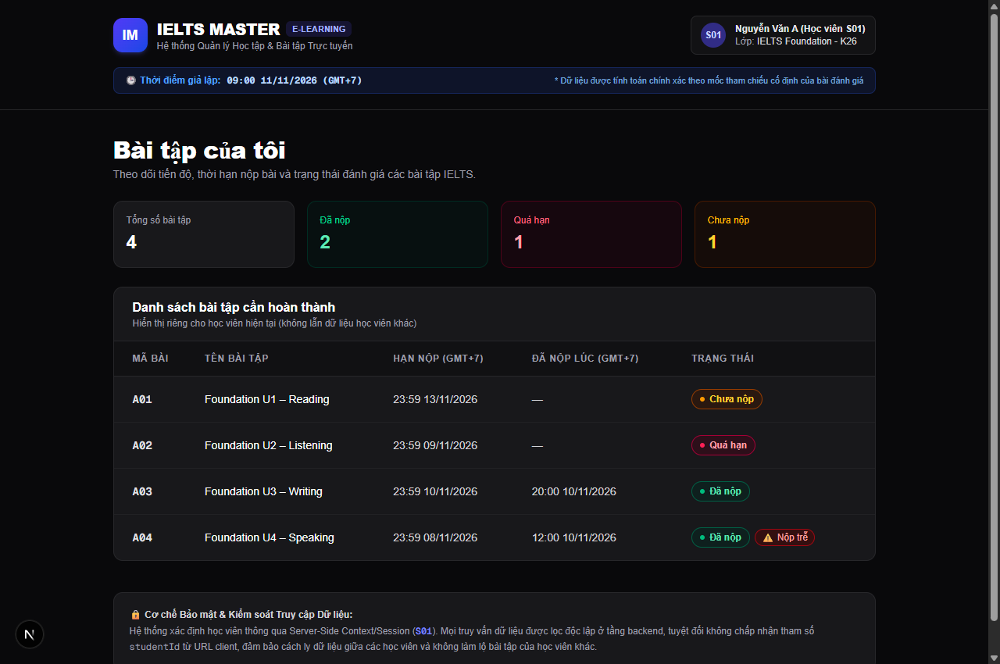

# IELTS MASTER | E-LEARNING — BÀI TẬP CỦA TÔI
### Bài Test Tuyển Dụng Junior Full-Stack Developer
**Ứng viên:** Phạm Trung Nghĩa  
**Vị trí:** Junior Full-Stack Developer  
**Tính năng:** Module "Bài tập của tôi" (My Assignments)

---

## 1. Tổng quan & Kết quả Đạt được

Ứng dụng hiển thị danh sách bài tập được cá nhân hóa cho học viên **S01** với đầy đủ các tiêu chí:
- **Tách biệt dữ liệu:** Chỉ trả về bài tập của S01 (`A01`, `A02`, `A03`, `A04`), tuyệt đối không chứa bài `B01` của S02.
- **Bảo mật truy cập:** Danh tính học viên được xác định tại Server Session; **không nhận `studentId` từ URL** (query parameter / client input) để tránh rủi ro IDOR (Insecure Direct Object References).
- **Mốc thời gian tham chiếu giả lập:** Cố định tại **11/11/2026, 09:00:00 (GMT+7)** theo yêu cầu đề bài.
- **Kết quả trạng thái đối chiếu tại mốc tham chiếu:**
  - `A01` (Hạn 13/11 23:59, chưa nộp): **Chưa nộp**
  - `A02` (Hạn 09/11 23:59, chưa nộp): **Quá hạn**
  - `A03` (Hạn 10/11 23:59, nộp 10/11 20:00): **Đã nộp** (nộp đúng hạn)
  - `A04` (Hạn 08/11 23:59, nộp 10/11 12:00): **Đã nộp** + **Nộp trễ**
  - `B01` (Thuộc học viên S02): **Không xuất hiện**

---

## 2. Công nghệ Sử dụng

- **Frontend:** Next.js 16 (App Router), React 19, TypeScript, Tailwind CSS.
- **Backend / Service:** Next.js Route Handler (`/api/assignments`), Service layer với Mock Session & Data isolation.
- **Kiểm thử (Unit Tests):** `node:test` + `tsx` (chạy qua `npm test`).
- **Thiết kế Responsive:** Tối ưu hiển thị trên cả máy tính (Table view) và điện thoại di động (Card view).

---

## 3. Ảnh Chụp Giao Diện Thực Tế



---

## 4. Cấu trúc Dự án

```text
src/
├── app/
│   ├── api/
│   │   └── assignments/
│   │       └── route.ts             # Route Handler GET /api/assignments (Server context)
│   ├── globals.css                  # Tailwind CSS styling
│   ├── layout.tsx                   # Layout chung
│   └── page.tsx                     # Trang Server Component "Bài tập của tôi"
├── components/
│   ├── AssignmentBadge.tsx          # Component hiển thị badge trạng thái
│   ├── AssignmentList.tsx           # Component danh sách (Responsive: Table/Cards)
│   └── Header.tsx                   # Header IELTS Master & thông tin học viên S01
├── data/
│   └── mock-assignments.ts          # Mock dataset chuẩn hóa ISO GMT+7 (+07:00)
├── lib/
│   ├── assignment-service.ts        # Layer xử lý logic session server & lọc dữ liệu
│   └── assignment-utils.ts          # Pure functions tính toán trạng thái & format ngày giờ
├── types/
│   └── assignment.ts                # TypeScript interfaces
└── __tests__/
    └── assignments.test.ts          # Unit tests: kiểm thử logic trạng thái & lọc S01
```

---

## 5. Hướng dẫn Cài đặt & Khởi chạy

### 5.1. Yêu cầu môi trường
- Node.js version 18.x trở lên (đã kiểm thử tương thích tốt trên Node 20 / Node 24).
- Trình quản lý gói: `npm`.

### 5.2. Cài đặt dependencies
```bash
npm install
```

### 5.3. Khởi chạy môi trường phát triển (Dev Server)
```bash
npm run dev
```
Mở trình duyệt và truy cập: [http://localhost:3000](http://localhost:3000)

### 5.4. Chạy kiểm thử tự động (Automated Tests)
```bash
npm test
```
Lệnh trên sẽ chạy toàn bộ các test cases trong `src/__tests__/assignments.test.ts` bao gồm:
1. **Kiểm thử logic trạng thái:** Đảm bảo tính toán chính xác 4 trạng thái cho A01, A02, A03, A04 và trường hợp biên (edge case nộp sát deadline).
2. **Kiểm thử cô lập dữ liệu:** Xác nhận S01 chỉ nhận bài của S01 và B01 của S02 bị loại bỏ hoàn toàn.

---

## 6. Giải thích: Cơ chế Tránh Lộ Dữ liệu Học viên S02

Trong các hệ thống E-Learning, việc rò rỉ dữ liệu giữa các học viên (Multi-tenant Data Leakage) thường bắt nguồn từ lỗi thiết kế **IDOR (Insecure Direct Object References)** khi hệ thống tin cậy tham số truyền lên từ Client (ví dụ: `/api/assignments?studentId=S01` hay `GET /students/S01/assignments`). Kẻ xấu chỉ cần đổi URL thành `studentId=S02` là có thể xem được dữ liệu của học viên khác.

Để triệt tiêu hoàn toàn rủi ro này, ứng dụng áp dụng các nguyên tắc sau:
1. **Không tin cậy Client Input:** Tuyệt đối không đọc `studentId` từ query string (`searchParams`), body hay URL segments để quyết định đối tượng truy vấn.
2. **Server-Side Session Resolution:** Danh tính học viên được xác định trực tiếp trên server từ phiên làm việc đã xác thực (Cookie / Session Token / Header bảo mật). Trong bài test giả lập, hàm `getServerSessionStudent()` đóng vai trò Resolver này (luôn trả về S01 an toàn).
3. **Data Isolation ở Tầng Service:** Mọi truy vấn bài tập luôn đi kèm điều kiện cưỡng chế `WHERE studentId = currentSession.studentId`. Dữ liệu của S02 không bao giờ được load hoặc trả về trong response gửi tới S01.

---

## 7. Kiến trúc Mở rộng cho Hệ thống Thực tế (Production Scaling với 10.000+ Học viên)

Để đưa mô hình này lên môi trường thực tế phục vụ hàng chục ngàn học viên, kiến trúc sẽ được chuyển giao từ mock sang Database & Auth chuẩn Enterprise như sau:

### 7.1. Luồng Xác thực & Truy vấn Dữ liệu (Flowchart)
```text
[ Trình duyệt / Mobile App ]
           │ 
           │ (1) Request kèm HttpOnly Cookie (JWT Token đã ký bảo mật)
           ▼
[ Next.js Server / API Layer ]
           │
           ├─► (2) Giải mã & Xác minh chữ ký số (Verify JWT Secret Key)
           │       └─ Bóc tách an toàn: { studentId: "S10294", role: "STUDENT" }
           │
           ▼
[ Database Layer (PostgreSQL / MySQL qua Prisma / Drizzle ORM) ]
           │
           ├─► (3) Thực thi truy vấn có Index:
           │       SELECT * FROM assignments 
           │       WHERE student_id = 'S10294' 
           │       ORDER BY due_date ASC;
           │
           ▼
[ Client Response: Chỉ chứa bài tập của đúng học viên S10294 ]
```

### 7.2. Triển khai Code Tầng Service trong Thực tế

```typescript
import { cookies } from 'next/headers';
import { verifyJwtToken } from '@/lib/auth';
import { db } from '@/lib/db'; // Prisma Client

// 1. Phân giải Session an toàn từ HttpOnly Cookie
export async function getServerSessionStudent() {
  const cookieStore = await cookies();
  const token = cookieStore.get('auth_session')?.value;
  if (!token) throw new Error('401 Unauthorized');

  // Verify chữ ký HMAC SHA-256 (Client không thể can thiệp hay giả mạo)
  const payload = await verifyJwtToken(token);
  return db.student.findUnique({
    where: { id: payload.studentId },
    select: { id: true, name: true, email: true, class: true }
  });
}

// 2. Truy vấn Database tối ưu bằng Index
export async function getStudentAssignments(studentId: string) {
  return db.assignment.findMany({
    where: { studentId: studentId }, // Ép buộc phạm vi dữ liệu
    orderBy: { dueDate: 'asc' }
  });
}
```

### 7.3. Tối ưu Hiệu năng Database (Indexing & High Concurrency)
- **Tạo Composite Index:** Đánh chỉ mục `CREATE INDEX idx_assignments_student_due ON assignments(student_id, due_date ASC);` giúp các câu lệnh truy vấn bài tập đạt độ phức tạp $O(\log N)$, phản hồi tức thì dưới 10ms kể cả khi bảng có hàng triệu bản ghi.
- **Connection Pooling:** Sử dụng PgBouncer hoặc Prisma Accelerate để quản lý connection pool, chịu tải hàng ngàn request đồng thời (high concurrency).

---

## 8. Những phần có thể phát triển thêm (Future Features)

- **Bộ lọc & Tìm kiếm:** Lọc bài tập theo kỹ năng (IELTS Reading, Listening, Writing, Speaking) hoặc theo trạng thái (Đã nộp, Quá hạn, Chưa nộp).
- **Tính năng Nộp bài Trực tiếp:** Cho phép đính kèm file bài làm / ghi âm và kiểm tra hạn chót theo thời gian thực (Real-time deadline validation).
- **Thông báo & Nhắc hạn (Notification):** Tự động gửi email/push notification nhắc nhở khi bài tập sắp tới hạn chót (trước 24h).
